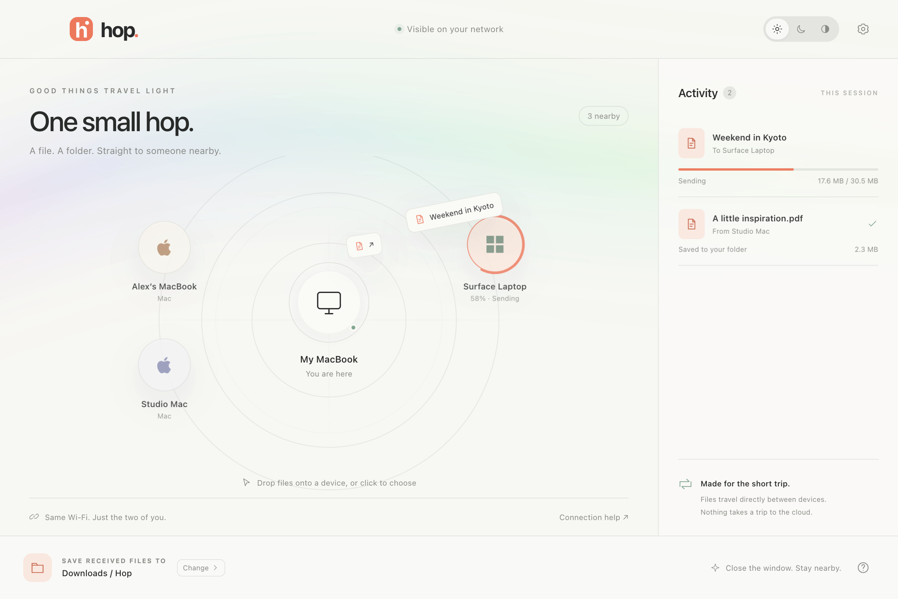
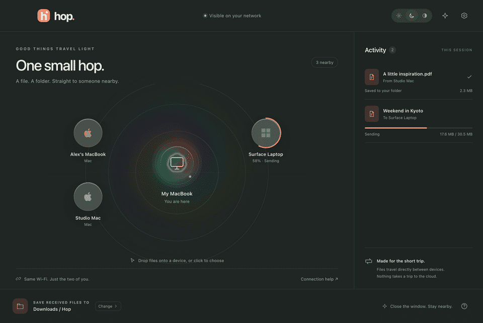

# Hop

**A little closer.** Mac 与 Windows 之间的本地文件共享应用。

在同一 Wi-Fi / LAN 下发现附近电脑，点击设备选择文件，或将文件与文件夹直接拖到设备上。接收方确认后开始传输；文件仅经过两台设备之间的局域网连接。无需账号、云服务或中转服务器。



上图为真实 Electron 窗口截图，附近设备及示例活动由测试夹具提供；正常运行仅显示实际发现的设备。

## v1.0.1 虹彩扩散

光波以雷达中心的本机图标为圆心，向四周扩散。每轮 2.4 秒，比初版 3.6 秒快 1.5 倍；支持 WebGL shader 和同样径向扩散的 Canvas 回退。点击右上角星芒按钮可重播。窗口隐藏时暂停动画，系统开启减少动态效果时显示静态光晕。



## Windows 快速体验

在 [Releases](https://github.com/mylea1/hop/releases) 下载 `Hop-windows-x64.exe`。首次标签构建完成后安装包才会出现，可在 [Actions](https://github.com/mylea1/hop/actions) 查看进度。

也可以安装 Node.js 22.12.0+ 后，在 PowerShell 中直接运行源码：

```powershell
git clone https://github.com/mylea1/hop.git
cd hop
npm ci
npm test
npm start
```

让 Mac 与 Windows 连接同一 Wi-Fi / LAN。Windows 防火墙提示时允许专用网络通信；Mac 首次提示时允许本地网络访问。互传、后台接收及哈希校验步骤见 [双机测试说明](docs/INSTALL.md)。

## 启动

开发需要 **Node.js 22.12.0 或更高版本**、npm，以及 macOS 13+ 或 Windows 10/11 x64。Windows 11 22H2+ 支持原生 acrylic 背景。安装打包后的应用不需要另外安装 Node.js。

```sh
npm ci
npm test
npm start
```

首次 `npm ci` 会下载 Electron，因此安装开发依赖需要网络；应用运行与传输不需要互联网。完整说明见 [安装与两机测试](docs/INSTALL.md)。

## 使用

- 两台电脑连接同一局域网并启动 Hop，允许系统的 Local Network / 防火墙提示。
- 将文件或文件夹拖到雷达中的目标设备；也可点击设备后选择文件或文件夹。
- 接收方点击 **Accept** 或 **Decline**。勾选 **Always accept from this device** 后，该设备后续发送会自动接收；可随时清空信任列表。
- 接收位置默认是系统下载目录下的 `Hop` 文件夹，可在窗口底部修改。同名文件会保存为 `photo (1).jpg`，同名文件夹以新的根目录保存，不合并或覆盖原目录。
- 关闭窗口后仍能接收。macOS 点击 Dock 图标重新打开；Windows 从托盘打开。完全退出请使用应用菜单或托盘菜单的 **Quit Hop**。
- 支持 Light / Dark / Auto、发送进度环、弧线文件动画与虹彩光波。WebGL 不可用时回退到 Canvas。

## 项目结构

```text
src/
  discovery/       UDP beacon、子网广播、多网卡、设备过期
  transfer/        HTTP offer、流式传输、目录与重名处理
  main/            Electron 生命周期、IPC、设置、启动日志
  renderer/        原生 HTML / CSS / JavaScript、雷达与动画
test/              Node 单元与集成测试
scripts/           图标生成、测试数据与 UI smoke 检查
assets/            三个图标概念、最终图标及平台图标
docs/              安装、两机测试、构建与发布说明
.github/workflows/ 标签触发的三平台 Release 构建
```

没有 Vue、React、打包器或前端运行时依赖。网络与文件 I/O 均在 Node 主进程执行，renderer 通过 preload 中的 IPC 接口调用。

## 网络与数据

设备每 1.5 秒向所有可用 IPv4 子网广播地址的 **UDP 47800** 发送小型 JSON beacon。beacon 包含协议版本、持久化随机设备 ID、名称、平台和随机 HTTP 端口。发现列表忽略自身，设备在 10 秒没有新 beacon 后过期；网络接口在广播时重新枚举。

发送方先提交路径与大小清单，接收方确认后逐个流式上传。目录结构、空目录和零字节文件会保留。接收路径经过校验，同名文件使用排他创建；未完成的文件会清理。传输不依赖公网，不经过第三方，当前版本不提供断点续传。发现使用 IPv4 UDP；仅 IPv6 网络、隔离访客 Wi-Fi 或屏蔽广播的网络无法自动发现。

“Always accept”按对方设备 ID 保存到本机设置。它是接收便利设置，不是账号或加密配对；应用采用局域网 HTTP 直传。

## 测试

```sh
npm test
npm run test:integration
npm run test:ui
```

网络测试先于 UI 实现：同一 Node 进程内启动两个 UDP / HTTP 设备实例，执行发现、传输嵌套文件夹与 3 MiB 文件，再比较 SHA-256。其他测试覆盖重名、接收拒绝、路径校验与设置持久化。Node 测试无须启动 Electron。

`test:ui` 启动 Electron 做界面与主进程检查，需要本地图形桌面。自动化检查无法代替真实 Mac 与 Windows 之间的首次权限、广播可达性及安装验证，具体步骤见 [INSTALL.md](docs/INSTALL.md)。

本机验证：Node 核心测试 **23/23** 通过；macOS 上真实 Electron 界面测试 **12/12** 通过，包含 3 MiB 文件哈希、后台接收、拖放桥接与 Canvas 回退。打包后的 Apple silicon 应用已验证网络启动及窗口可见。独立审查记录见 [网络审查](docs/NETWORK-REVIEW.md) 与 [UI 审查](docs/UI-REVIEW.md)。Windows 原生安装和两台实体机器之间的网络验证待实际部署完成。

## 打包

```sh
npm run icons
npm run pack
npm run dist:mac
npm run dist:win
```

Mac 安装包必须在 Apple 硬件运行 macOS 构建；Windows 安装包推荐在 Windows 构建。输出位于 `dist/`：

| 平台 | 安装包 |
| --- | --- |
| Apple silicon Mac | `Hop-mac-arm64.dmg` |
| Intel Mac | `Hop-mac-x64.dmg` |
| Windows x64 | `Hop-windows-x64.exe` |

将项目作为 GitHub 仓库根目录提交，推送与 `package.json` 版本一致的 `v*` 标签即可触发三个原生 runner 构建；全部成功后才创建 Release。签名配置、首次安装提示与发布流程见 [RELEASE.md](docs/RELEASE.md)。

## 调试

启动日志会记录 Electron / Node 版本、HTTP 端口、发现状态、窗口加载与异常。窗口启动时直接显示，避免因等待 `ready-to-show` 而一直不可见；正常关闭窗口仍会进入后台。应用内可打开日志位置。发现或启动失败时，先查看 `startup.log`，再按 [INSTALL.md](docs/INSTALL.md) 的网络排查步骤处理。

MIT License。
