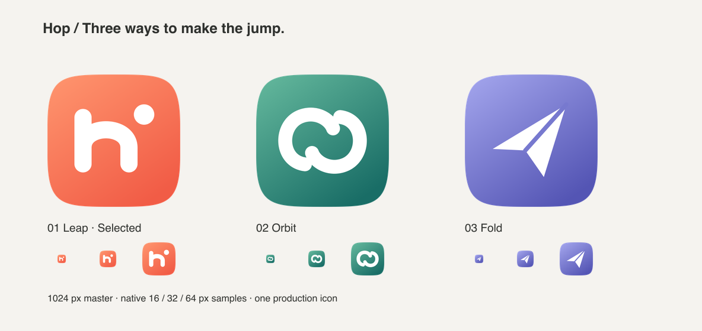

# Hop 图标

三款均为可重建的 SVG，生成 1024 × 1024 PNG，在透明背景上使用 macOS squircle 轮廓。

| 概念 | 设计 | 小尺寸比较 |
| --- | --- | --- |
| **Leap（采用）** | 珊瑚色、圆润小写 h、跃起的圆点 | 16 px 保留 h 与圆点两处特征；对比度强，轮廓清楚 |
| Orbit | 绿色、相互靠近的两道圆弧 | 16 px 的弧线更容易读作通用链环 |
| Fold | 紫色、折纸飞行图形 | 16 px 轮廓清楚，但更接近邮件类应用 |

生产构建只使用 Leap。另两款留在 concepts 目录作为设计对比记录，不进入安装包。`npm run icons` 生成 `icon.svg`、1024 px `icon.png`、多分辨率 `icon.icns` 和 `icon.ico`。无需在线生成服务或字体。
